# SkillForge

**A self-improving agent that turns its own experience into verified, reusable skills and typed memory — and an evaluation that checks whether the improvement is real.**

Most "self-improving agent" demos show a before/after run. SkillForge treats improvement as a claim to be tested:
the same task stream is run under four conditions (frozen, memory only, skills only, both) over many seeds, with
read-only probes for transfer and retention, paired comparisons against the frozen agent, and an explicit hunt for
cases where self-evolution made things *worse*.

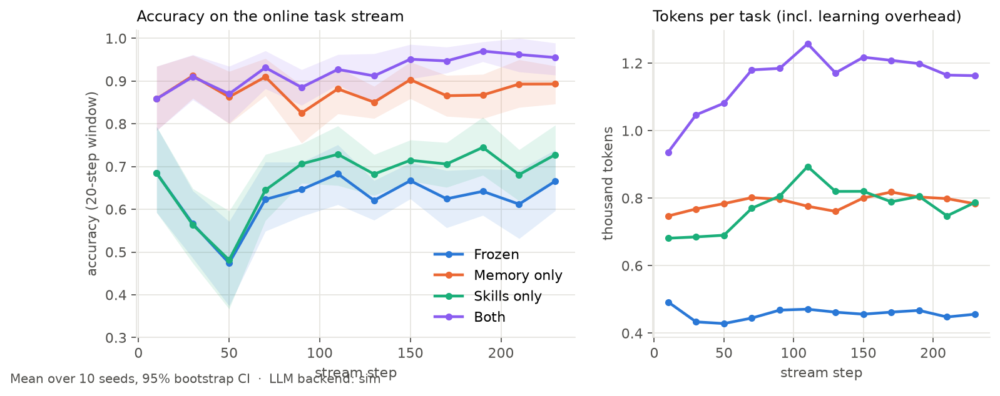

> **Read this first — what the numbers are and are not.**
> The curves in this README come from `SimLLM`, a deterministic stand-in for a language model (no API key was
> available while building). Everything *around* the model is real and exercised end to end: LangGraph agent, MCP
> tools, sandboxed code execution, Redpanda/Kafka, distiller, replay-test gate, Go + Postgres/pgvector memory service,
> LongMemEval retrieval. The model's behaviour is not: its competence, its error rate (`p_flaw = 0.55`) and how it uses
> skills are my assumptions (see [`llm/sim.py`](src/skillforge/llm/sim.py)). So the results show that **the system and
> the measurement harness work and surface the failure modes they should**; they do **not** show that a real LLM improves by
> this much. A small run against a real model (Gemini 3.5 Flash-Lite) is reported in [section 6](#6-real-model-check-gemini-35-flash-lite):
> the pipeline works end to end with it, but on these tasks the real model is already at ceiling, so it shows **no accuracy gain and
> a token cost**. The harness is identical for every backend (`--llm sim | anthropic | gemini`).
> The LongMemEval retrieval results are real (real data, real retrieval code, no simulated model).

---

## Contents

1. [Architecture](#architecture) · 2. [Tech stack and why](#tech-stack-and-why) · 3. [How skills and memory work](#how-skills-and-memory-work)
4. [Evaluation design](#evaluation-design) · 5. [Results](#results) · 6. [Dashboard](#dashboard) · 7. [Run it](#run-it) · 8. [Deploy](#deploy-docker-helm-terraform-eks)
9. [Repository layout](#repository-layout) · 10. [Phased build plan](#phased-build-plan) · 11. [Limitations](#limitations-and-honest-caveats)

---

## Architecture

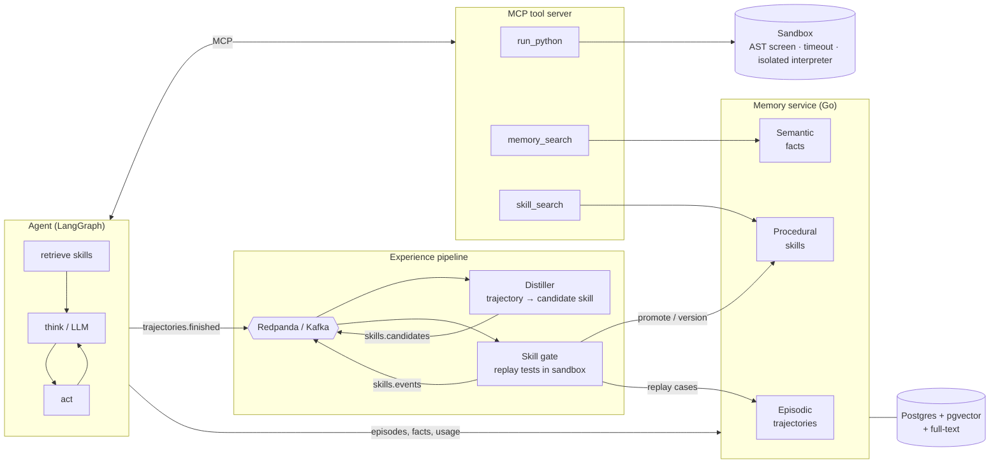

A finished trajectory is published to Redpanda. The **distiller** proposes a candidate skill (an executable Python
function with a docstring). The **gate** replays it in the sandbox against verified past successes and only then promotes
it to the library, where it is versioned, usage-tracked and deprecated when it fails.

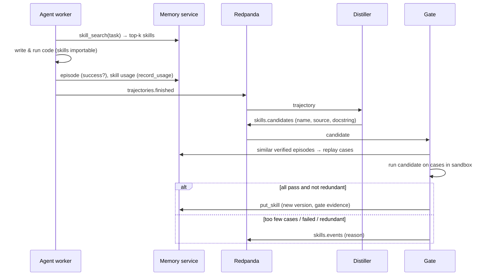

### Skill lifecycle

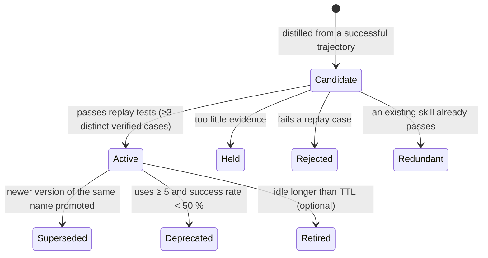

### Memory write and update rules

| Store | Write rule | Update / conflict rule | Expiry |
|---|---|---|---|
| **Episodic** | append-only full trajectories | never mutated | retained |
| **Semantic** (facts keyed by `(subject, predicate)`) | create | same object → *reinforce* · newer `valid_from` → *supersede* (old kept as history) · **older** `valid_from` → stored as *history*, never returned · tie → higher confidence wins, else *reject* | optional TTL; filtered at read time and reaped in the background |
| **Procedural** (skills) | only through the gate | new version supersedes the active one; deprecation from observed failures | optional idle retirement |

Semantic retrieval is **hybrid**: pgvector cosine ∪ Postgres full-text (`ts_rank_cd`), fused with reciprocal rank fusion.

---

## Tech stack and why

| Concern | Choice | Reason |
|---|---|---|
| Agent | **LangGraph** (`retrieve → think → act`) | explicit graph, easy to trace trajectories |
| Tools | **MCP** (`mcp` 2.x `MCPServer`), in-memory transport for experiments, stdio/HTTP for deployment | one tool surface for every LLM backend; the tool set *is* the experimental condition |
| LLM | `GeminiLLM` (tested with a real model), `AnthropicLLM` (implemented, **untested** - no key), and `SimLLM` (offline) | reproducible without a key; one switch to go real |
| Event bus | **Redpanda** (Kafka API) behind a `Bus` interface; in-memory twin for tests | single binary, light on k8s; deterministic experiments |
| Memory service | **Go** (`net/http`, `pgx`) + **Postgres 16 / pgvector** | small static binary; hybrid search in one database |
| Rules reference | Python implementation of the same rules + **shared JSON conformance fixtures** run against both | experiments need thousands of fast runs; production needs Postgres; fixtures stop them drifting |
| Sandbox | subprocess, `-I -S`, AST screen (import allow-list, no `open/exec/eval`/dunders), timeout; **in k8s**: read-only root FS, no SA token, deny-all NetworkPolicy | defence in depth (the subprocess alone is *not* a security boundary) |
| Packaging | Docker, Docker Compose, **Helm** chart, **Terraform** (VPC + EKS + ECR) | local → cluster → cloud |

---

## How skills and memory work

**Distiller** (`skills/distiller.py`) keeps imports and function definitions from a successful trajectory's final code,
renames `solve` to a descriptive name, and attaches a docstring (heuristic offline; an LLM namer is included for real runs).

**Gate** (`skills/gate.py`) — a candidate joins the library only if:

1. it passes the static screen;
2. there are **≥ 3 distinct verified cases** — the origin episode plus similar past successes retrieved from episodic memory
   (filtered by input signature and wording similarity) — otherwise it is *held* ("insufficient evidence");
3. it passes **every** case when executed in the sandbox;
4. no existing skill already passes all the cases (behavioural de-duplication).

A real example from `skillforge demo` (`--seed 3 --n 120`):

```text
stream accuracy: 0.83 over 84 scored tasks
  active  parse_duration_string_units v1  uses=6  gate={'cases': 3, 'passed': 3, 'reason': 'passed all replay cases'}
  active  days_apart_dates_iso        v1  uses=3  gate={'cases': 4, 'passed': 4, ...}
  active  most_common_word_text       v1  uses=1  gate={'cases': 3, 'passed': 3, ...}
  ...
 {"type": "insufficient", "name": "add_nested_list_however", "reason": "2 < 3 verified cases"}
 {"type": "promoted",     "name": "shift_start_date_days",   "reason": "passed all replay cases"}
 {"type": "rejected",     "name": "add_nested_list_however", "reason": "failed 1 of 3 replay cases"}
```

---

## Evaluation design

* **Task environment** — 12 verifiable programming-task families (Roman numerals, durations, brackets, anagrams, dates, base
  conversion, CSV sums, run-length encoding, nested sums, …) with hidden reference solutions, three phrasings each, and **known,
  partially-triggered bugs** (so a flawed solution can pass a single instance by luck — exactly what the gate must catch);
  plus **fact tasks** over a changing world (service regions/ports that move, on-call rotations that expire, late-arriving
  stale notes) that can only be answered from memory.
* **Four conditions** on the *same* stream, same seeds: **Frozen**, **Memory only**, **Skills only**, **Both** (+ ablations:
  no gate, 1-case gate, memory without conflict/expiry rules). 10 seeds × 240-step streams.
* **Read-only probes** every 40 steps (no learning while probing): *held-in* fresh instances, **transfer** to 4 unseen composite
  families (e.g. add two Roman numerals = parse ∘ format), **retention** of the 4 earliest-taught families, and fact queries.
* **Paired analysis**: identical tasks across conditions, so "helped / broke" is counted per task against the frozen agent;
  CIs are bootstrap over seeds.
* **Cost**: tokens counted from real text in/out, including the distillation overhead; priced at Haiku 5.5 list prices ($0.10 / $0.50 per M tokens) and configurable.
* **Public memory benchmark**: [LongMemEval](https://github.com/xiaowu0162/LongMemEval) (`longmemeval_s_cleaned`).

---

## Results

All numbers: 10 seeds, LLM backend `sim` (see the caveat at the top). Intervals are 95 % bootstrap CIs over seeds.

### 1. Learning curves — four conditions

| Condition | Code accuracy (2nd half) | Fact accuracy at end (probe) | Tokens / task | $ / 1k tasks | Distillation share of cost |
|---|---|---|---|---|---|
| Frozen | 82.6 % [80.9, 84.1] | 23 % | 458 | 0.068 | – |
| Memory only | 82.6 % [80.9, 84.1] | **100 %** | 788 | 0.103 | – |
| Skills only | **92.8 %** [90.0, 95.5] | 23 % | 777 | 0.102 | 13.5 % |
| Both | **92.8 %** [90.0, 95.5] | **100 %** | 1155 | 0.142 | 9.6 % |

Skills help code tasks, memory helps fact tasks, and the two are additive here (they touch different task types by
construction). **Improvement is not free:** `Both` uses about 2.5× the tokens of the frozen agent per task, because the retrieved skill
catalogue is added to every prompt and distillation costs tokens of its own. See the left/right panels above and:

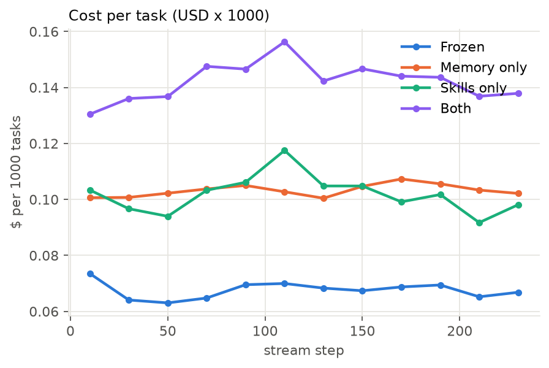

### 2. Transfer, retention, facts (read-only probes)

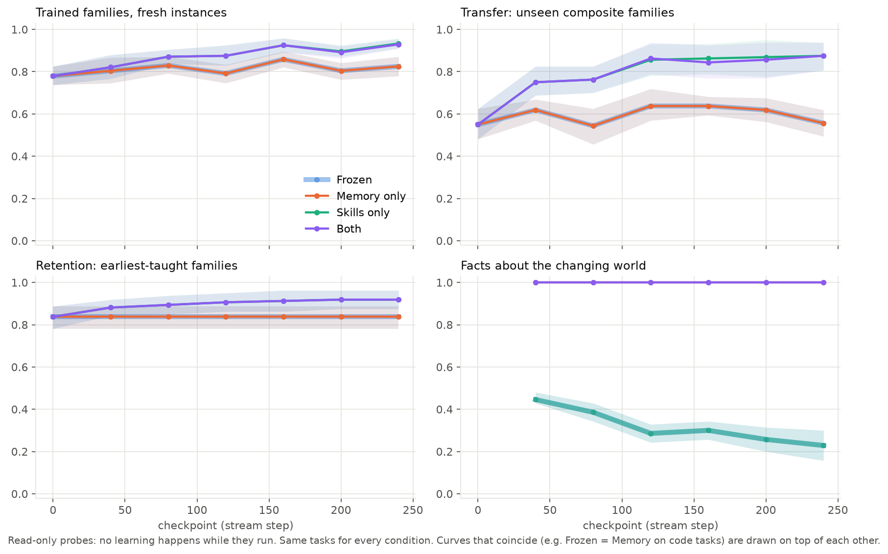

| At the final checkpoint | Frozen | Memory | Skills | Both | Both vs Frozen (paired, 95 % CI) |
|---|---|---|---|---|---|
| Held-in families, fresh instances | 82 % | 82 % | 93 % | 93 % | **+10 pp** [+7, +14] |
| **Transfer to unseen composite families** | 56 % | 56 % | 88 % | 88 % | **+32 pp** [+23, +41] |
| **Retention of earliest-taught families** | 84 % | 84 % | 92 % | 92 % | +8 pp [−1, +17] |
| Facts about the changing world | 23 % | 100 % | 23 % | 100 % | memory only |

* **Transfer is real in this setup**: composites reuse component skills (`parse_duration` → total duration) that were never trained on the composite.
* **No degradation of old abilities was observed**: retention never fell below its starting level in any condition (the +8 pp is not statistically distinguishable from 0).
  The frozen baseline is flat, so this is not a ceiling effect. I did not find an interference mechanism with this library size (~12 skills); a larger library is where I'd look next.

### 3. When self-evolution made things worse

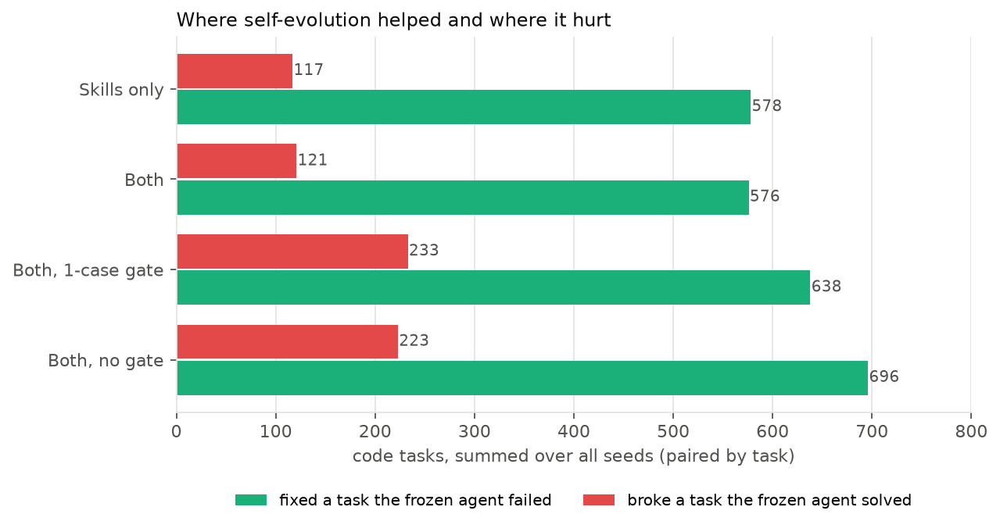

Paired against the frozen agent on identical code tasks (5 096 per condition, summed over seeds):

| Variant | Fixed a task the frozen agent failed | Broke a task the frozen agent solved | Net | Flawed skills in library* |
|---|---|---|---|---|
| Skills only | 578 | 117 | +461 | 18 % (22 / 121) |
| Both (3-case gate) | 576 | 121 | +455 | 19 % (23 / 122) |
| Both, **1-case gate** | 638 | 233 | +405 | 30 % (41 / 135) |
| Both, **no gate** | 696 | 223 | +473 | 28 % (57 / 204) |

\* ground-truth audit: each skill re-run on 25 fresh instances of the family it came from; "flawed" = any failure.

Why it got worse — the cases, by cause (Both, 121 broken tasks):

1. **A flawed skill passed the gate — 64 (53 %).** The simulated model sometimes writes a solution with a bug that only triggers on some inputs
   (e.g. run-length encoding that breaks for runs ≥ 10, ~18 % of inputs). A few lucky passes are enough to clear a 3-case gate, and from then on
   every task of that family inherits the bug. *Self-evolution turned a one-off mistake into a permanent one.* With a 1-case gate the harm doubles (233).
2. **The right-looking skill for the wrong task — 30 (25 %).** Retrieval is lexical/semantic and look-alike skills exist (Roman → int vs int → Roman,
   date difference vs date shift). The wrong skill ran and returned a plausible answer.
3. **Unclassified — 27 (22 %).** Tasks broken with a skill library present but no skill recorded as used; I did not instrument these further.

Two further honest findings:

* **The gate trades harm for speed.** Removing it gives the *highest* net gain (+473) — skills arrive sooner — but twice the harm and more flawed skills. The 3-case gate halves harm for a ~4 % lower net gain; the 1-case gate is strictly worse than both.
* **Deprecation almost never fires** (0.3 of ~12 skills per run). The rule (`uses ≥ 5` and success `< 50 %`) is too lenient for partially-triggered bugs, which fail 18–50 % of the time. The gate, not deprecation, does the protecting. Tuning this is the obvious next step.

**Memory without rules is worse than no conflict handling would suggest:** with append-only facts (no supersede / history / expiry) fact accuracy is **47 %** versus **100 %** with the rules — 206 of 943 answers were stale values.

### 4. Skill-library growth and retention

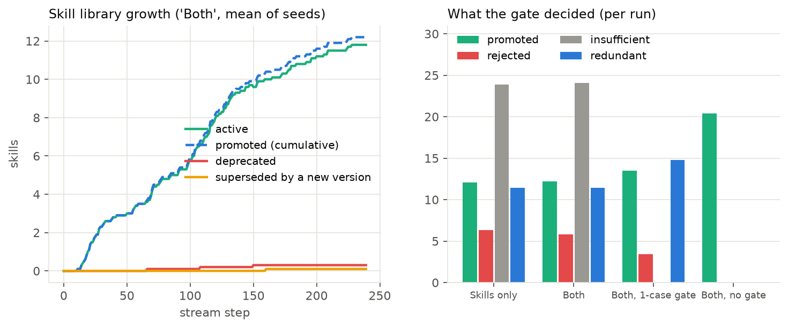

Per run (Both): ~12 skills promoted, 11.8 still active at the end, 0.3 deprecated, 24 candidates held for insufficient evidence, ~6 rejected, ~11 judged redundant. Growth is steady for the first ~140 steps and
flattens as the 12 families are covered.

### 5. Memory retrieval on LongMemEval (real data)

Every turn of a ~50-session chat history is written to the memory service as a fact; the question is the query; the metric is
`recall_any@k` over distinct sessions (is any evidence session in the top-k?). Abstention questions are excluded.

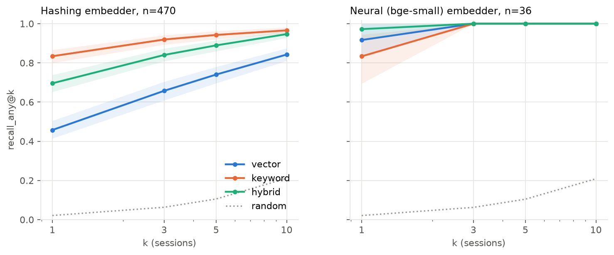

**Hashing embedder (CPU, no model) - all 470 non-abstention questions:**

| Retrieval | recall@1 | @3 | @5 | @10 | turn hit@10 |
|---|---|---|---|---|---|
| vector | 46 % | 66 % | 74 % | 84 % | 60 % |
| keyword | 83 % | 92 % | 94 % | 97 % | 87 % |
| hybrid | 70 % | 84 % | 89 % | 95 % | 77 % |
| *random* | 2 % | 6 % | 11 % | 21 % | – |

**Neural embedder (`bge-small-en-v1.5` via fastembed) - a stratified subset of only 36 questions (6 per type; the full run did not fit my time budget, so treat these as indicative, with wide intervals):**

| Retrieval | recall@1 | @3 | @5 | @10 | turn hit@10 |
|---|---|---|---|---|---|
| vector | 92 % | 100 % | 100 % | 100 % | 92 % |
| keyword | 83 % | 100 % | 100 % | 100 % | 89 % |
| hybrid | 97 % | 100 % | 100 % | 100 % | 94 % |
| *random* | 2 % | 6 % | 10 % | 21 % | – |

What this says:

* With the weak hashing embedder, **keyword (BM25) retrieval beats hybrid** (83 % vs 70 % recall@1): rank-fusing a poor signal with a good one dilutes the good one. Hybrid only pays off when both signals are decent.
* With a real embedding model, **hybrid is best at rank 1** (97 % vs 92 % vector, 83 % keyword on the 36-question subset), and everything saturates by k=3, so this subset cannot separate them beyond rank 1.
* Weak spots with the hashing embedder are *single-session-preference* questions (recall@5 53 % hybrid / 43 % vector): the evidence is paraphrastic, so lexical overlap with the question is low.
* LongMemEval's questions often share vocabulary with their evidence, which flatters keyword search; this is retrieval only, not end-to-end QA accuracy.

### 6. Real-model check (Gemini 3.5 Flash-Lite)

A genuine LLM exercised the same agent, MCP tools, sandbox, distiller, gate and memory service logic. **This is a sanity check, not an
experiment:** the free API tier allows 15 requests/min and 500/day, so I could afford one seed, a 50-step stream over **3 task families**
(`duration`, `date_diff`, `balanced`), two conditions (Frozen vs Both) and 10 probe tasks per checkpoint. Model: `gemini-3.5-flash-lite`, thinking level `minimal`.

| | Frozen | Both |
|---|---|---|
| Code accuracy, stream (40 tasks) | 40 / 40 | 40 / 40 |
| Held-in / transfer / retention probes, step 0 → 50 | 3/3 → 3/3 for each | 3/3 → 3/3 for each |
| Fact questions (stream) | 0 / 9 | **9 / 9** |
| Mean tokens per code task | 916 | 1050 (1131 when a skill was used, 950 when not) |
| Skills promoted / redundant / rejected / held | – | 3 / 4 / 2 / 6 |

What it shows, honestly:

* **The pipeline works with a real model**: real-model trajectories were distilled into skills, 3 passed the replay gate, and they were reused (8/8, 3/3 and 2/2 uses succeeded). The gate also rejected two candidates that failed *every* replay case (I did not investigate why) and de-duplicated four.
* **No accuracy gain is measurable**, because a modern model already solves these tasks perfectly (ceiling). The simulated model's headroom was my assumption; real headroom needs harder tasks.
* **Skills made code tasks cost more, not less**: +15 % tokens per task, because the retrieved skill catalogue is added to every prompt and the model still verifies by running code.
  That is the opposite sign to the simulated result's accuracy story, and it is the kind of thing only a real model can show.
* Memory helps on facts by construction (the frozen model cannot know them); notably, the frozen model tried to *find* the facts by introspecting the sandbox (`dir(...)`, `__builtins__`), which the AST screen blocked.
* One seed and ~40 tasks per condition: treat all of this as anecdotal.

```bash
GEMINI_API_KEY=... SKILLFORGE_GEMINI_MODEL=gemini-3.5-flash-lite SKILLFORGE_RPM=7   python scripts/run_experiment.py --llm gemini --seeds 1 --n 50 --every 50 --small-probes 2   --families duration,date_diff,balanced --conds frozen,both --workers 2 --out results/gemini
```

---

## Dashboard

A single self-contained HTML page (`docs/dashboard.html`, built by `skillforge report`) with learning curves, probes, library growth/retention,
harm analysis and LongMemEval tables; hover tooltips, light/dark theme.

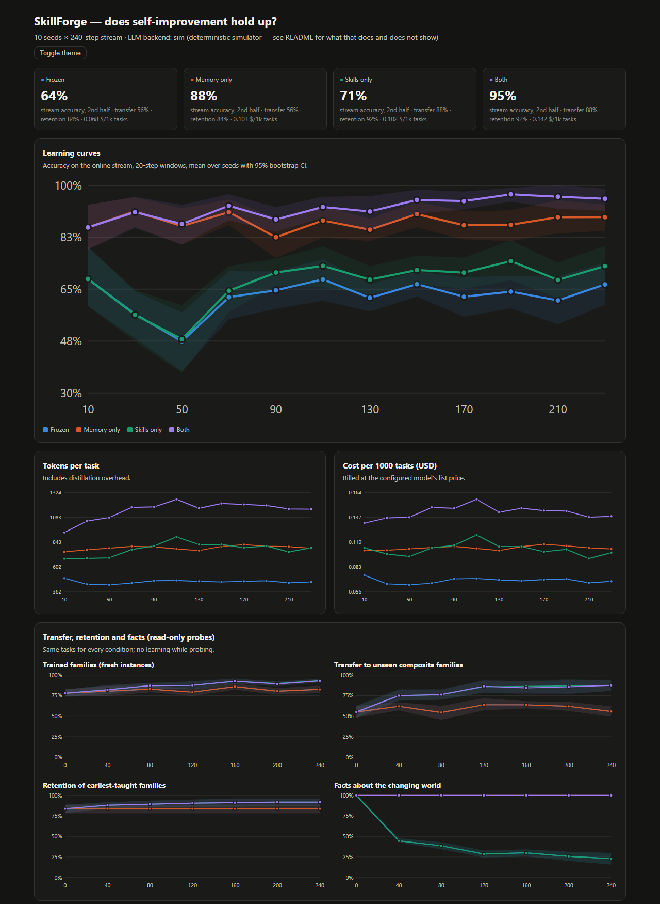
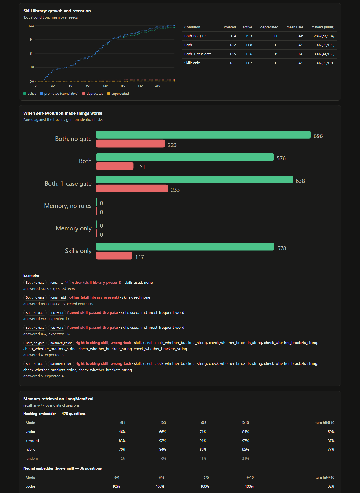

---

## Run it

Requirements: Python ≥ 3.11, Go ≥ 1.25 (only to build the service outside Docker), Docker.

```bash
python -m venv .venv && source .venv/bin/activate      # Windows: .venv\Scripts\activate
pip install -e ".[dev]"
pytest                                                 # unit tests (no services needed)

skillforge demo --seed 3 --n 120                       # one end-to-end run in-process, prints the skill library
python scripts/run_experiment.py --seeds 10 --n 240 --out results/main   # the full 7-condition experiment (~25 min on 16 cores)
skillforge report                                      # figures → docs/images, dashboard → docs/dashboard.html
```

**Full stack with the Go memory service, Postgres/pgvector and Redpanda:**

```bash
docker compose up -d postgres memory redpanda
MEMORY_URL=http://localhost:8080 KAFKA_BROKERS=localhost:19092 pytest tests/test_memory_http.py tests/test_kafka_pipeline.py
docker compose --profile pipeline up --build           # worker + distiller + gate as separate containers
```

**LongMemEval:**

```bash
curl -L -o data/longmemeval_s_cleaned.json https://huggingface.co/datasets/xiaowu0162/longmemeval-cleaned/resolve/main/longmemeval_s_cleaned.json
python scripts/run_longmemeval.py
```

**With a real model:** `ANTHROPIC_API_KEY=... python scripts/run_experiment.py --llm anthropic ...` or `GEMINI_API_KEY=... --llm gemini` (see section 6). Every task is several model calls, and free tiers are rate-limited; `SKILLFORGE_RPM` throttles the Gemini client.

### Tests

| Suite | What it proves |
|---|---|
| `tests/test_families.py` | every reference solution matches ground truth; each injected bug is partial (5–90 % trigger rate); sandbox blocks escapes and timeouts |
| `tests/conformance/*.json` | the **same** fixtures pass on the Python reference **and** the Go + Postgres/pgvector service |
| `memory-service/*_test.go` | fact conflict rules, deprecation threshold, rank fusion |
| `tests/test_learning.py` | skills are promoted through the gate; replay evidence never mixes task families |
| `tests/test_kafka_pipeline.py` | trajectory → Redpanda → distiller → gate → Go service → active skill |

---

## Deploy: Docker, Helm, Terraform (EKS)

* **Images**: `memory-service/Dockerfile` (distroless static Go binary), `docker/python.Dockerfile` (worker/distiller/gate), `docker/dashboard.Dockerfile` (unprivileged nginx).
* **Helm** (`deploy/helm/skillforge`): memory service (2 replicas, probes), Postgres/pgvector and Redpanda StatefulSets with PVCs, distiller / gate / worker, dashboard, a generated DB secret, and a **NetworkPolicy**
  that confines worker pods (which execute generated code) to the memory service, Redpanda and DNS. All pods run as non-root with a read-only root filesystem and no service-account token.
  Use managed Postgres/Kafka in production via `postgres.externalUrl` / `redpanda.externalBrokers`.
* **Terraform** (`deploy/terraform`): VPC (2 AZ, private nodes, one NAT), EKS 1.31 with a managed node group, the EBS CSI driver (for the PVCs), VPC-CNI network-policy enforcement and three ECR repositories.

```bash
cd deploy/terraform && terraform init && terraform apply          # creates billable AWS resources (~$0.2/h EKS + nodes + NAT)
$(terraform output -raw kubeconfig_command)
# build & push the three images to the ECR URLs in `terraform output ecr_repositories`, then:
helm install sf deploy/helm/skillforge --set image.registry=$(terraform output -raw ecr_registry)
```

**Verification status (honest):** `helm lint` and `helm template` pass; `terraform fmt` + `terraform validate` pass; the compose stack (Postgres, Go service, Redpanda) was run and tested.
I have **not** applied the Terraform or installed the chart on a live cluster — there was no cluster or AWS account available while building.

---

## Repository layout

```text
src/skillforge/
  envs/          task families, sandbox, task stream and probe sets
  llm/           LLM interface · AnthropicLLM · SimLLM
  agent/         LangGraph agent and trajectory model
  mcp_server/    MCP tool server (tools depend on the condition)
  memory/        reference memory rules, clients (local / HTTP), embedders
  bus/           in-memory and Kafka/Redpanda event bus
  skills/        distiller · gate · learning pipeline
  eval/          runner, analysis, LongMemEval
  dashboard/     figures and the HTML dashboard
memory-service/  Go service (Postgres + pgvector), schema, unit tests
deploy/          Helm chart · Terraform (EKS)
docker/ docker-compose.yml
tests/ scripts/ docs/ results/
```

## Phased build plan

| Phase | Deliverable | Status |
|---|---|---|
| 0 | Architecture decisions, repo, toolchain ([`docs/PLAN.md`](docs/PLAN.md)) | done |
| 1 | Task environments, sandbox, LLM interface, `SimLLM` | done |
| 2 | Memory rules (Python) + Go service on Postgres/pgvector, shared conformance fixtures | done |
| 3 | MCP tool server + LangGraph agent | done |
| 4 | Event bus, distiller, replay-test gate, skill lifecycle | done |
| 5 | Evaluation: 4 conditions + ablations, transfer, retention, LongMemEval | done |
| 6 | Dashboard and figures | done |
| 7 | Docker, Compose, Helm, Terraform | done (chart/terraform validated, not applied to a live cloud) |
| 8 | README, screenshots, GitHub | done |

## Limitations and honest caveats

* **The headline curves use a simulated model**, and the one real-model run (section 6) is tiny and at ceiling. `AnthropicLLM` has never been run against the real API.
* **The headline curves use a simulated model.** They validate the pipeline and the measurement, not real-LLM improvement. The mechanisms behind the harm cases (a flaw that triggers on part of the inputs; lexical skill selection) are plausible for real models but their *rates* are assumptions.
* The task families are small and synthetic; skills there are short functions. Real agent skills (tool sequences, prompts) are messier.
* Fact extraction is rule-based (regexes on a fixed phrasing); an LLM extractor is the natural replacement and would add its own error.
* Embeddings in the experiment are a deterministic hashing embedder; LongMemEval shows how much that matters (below).
* LongMemEval is evaluated for **retrieval** only. End-to-end answer accuracy needs an LLM reader and judge and is not reported.
* Sandbox isolation on a developer machine is best-effort; use the Kubernetes deployment (read-only FS, no network) for anything untrusted.
* The distillation overhead for the offline namer is an estimate; with `AnthropicLLM` it is measured.

## License

MIT
